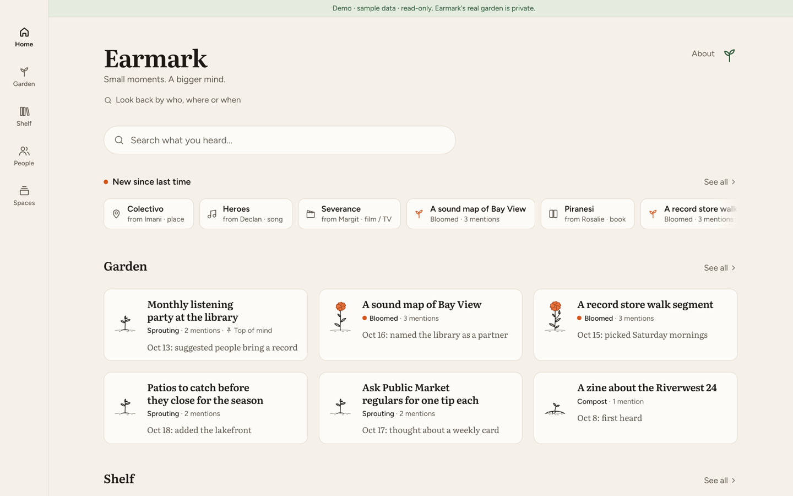
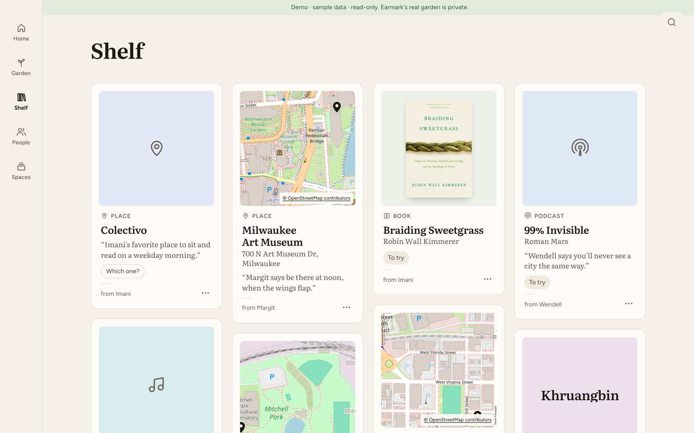
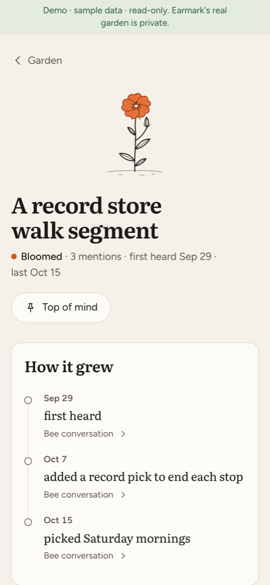
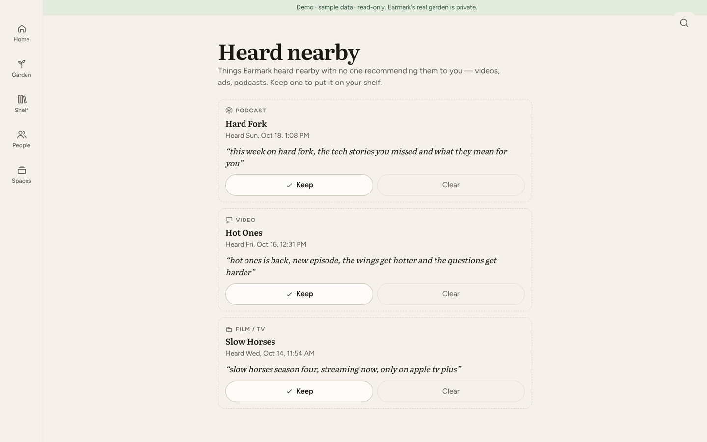

# Earmark

**Bee hears everything. Earmark keeps the two things you actually lose: the tips friends give you, and the ideas you keep saying out loud.**

Earmark is an [eve](https://eve.dev) agent that sits on top of a [Bee](https://docs.bee.computer) wearable. It finds the recommendations and ideas in your conversations, follows them across weeks, and finishes the work: a shelf of tips with who said them and a link to play or visit each one, ideas that grow with every mention and bloom into a one-page draft, and Bee to-dos on your wrist that link back.

Built for the Bee track of the Build, Ship, Shape: Amazon Developer Hackathon (2026).

- **Try it:** https://earmark-demo.vercel.app. The full app with invented sample data for an invented owner, Sam, in Milwaukee. No sign-in, read-only. Earmark's real garden is private.
- **Code:** this repo (MIT). The Bee plumbing is also a reusable package, [`eve-bee`](packages/eve-bee).
<!-- TODO(Oct 22): add the video link and the Devpost link here -->

## Why

A Bee owner has hours of transcripts a week. Bee's app turns them into summaries, a diary, suggested to-dos and facts. The problem is not capture. It is that nothing in a transcript turns into something you do. Bee captures moments; Earmark finds patterns across weeks and finishes the work.

| What goes wrong | What Earmark does |
|---|---|
| "Someone told me to try something, and I can't remember what or who." | Every tip lands on the **Shelf** with the friend's first name, cover art, and a link to play, watch or visit it, plus a Bee to-do. |
| "I keep saying the same idea and never write it down." | Ideas are plants in a **Garden**. Each mention grows one; the third makes it bloom, even mid-conversation, with a one-page draft that lists when you said it. |
| "Bee picks up the TV and gives me nonsense." | Anything overheard with nobody recommending it to you goes to a quiet **Heard nearby** list, not your Shelf. |
| "Bee mishears names." | Earmark searches Apple Music, MusicBrainz, TMDB, Open Library, OpenStreetMap and then the web, and asks **"Which one?"** when it is unsure instead of guessing, on your wrist as well as on the page. Fix any tip from its page, by editing its Bee to-do, or by saying it. |
| "I never closed the loop." | Rate what you tried, and Earmark drafts a thank-you card for the friend who told you. |

## What it does

- **Garden.** Ideas you say out loud are clustered over weeks: compost, sprouting, bloomed at the third mention, then a one-page draft. A single passing mention stays quiet (listed under "Heard once") so the garden shows ideas you keep coming back to.
- **Shelf.** Tips people give you, with a 25-word excerpt and the recommender's first name. Songs and albums (added to your Apple Music, with nearby shows), films and shows (synopsis, cast, where to stream, trailer), books, podcasts, videos and places (address, map, and hours, phone and menu when they can be found).
- **"Earmark that."** Say it after a friend's tip and it is saved at once, credited to them.
- **Research.** When an idea blooms, Earmark researches it on its own; you can also ask ("Earmark that … include research", or **Research this** on an idea). It searches the web, reads the best five pages and writes a short brief with numbered sources. Your Bee to-do then carries the one-line takeaway.
- **Heard nearby.** Ads, videos and podcasts playing nearby are kept apart; keep one to move it to the Shelf.
- **People and thank-yous.** Who has given you the best tips, and a card to thank them.
- **Look back** by who, where or when; **Spaces** that collect related tips and ideas.
- **Ask it.** An MCP server (a standard way for AI assistants to call tools) answers "what did Imani recommend?" for Claude, and an Alexa+ simulator in the app does the same by voice.

## It acts before you ask

Capturing is half the job. When Earmark hears something, it keeps working on it without being asked, and only checks in when it needs you.

| You said | What Earmark does next, on its own |
|---|---|
| A friend's favorite bar, which no map knows yet | Searches the web, reads the name and street address, pins it on the map (that is how it found Diaspora, a Milwaukee bar OpenStreetMap doesn't list), looks up its hours, and asks once on your wrist: "Is this the one?" |
| An idea, for the third time | Blooms it into a one-page draft, researches who is already doing it, and buzzes you: "draft and research ready". |
| A song or album (or one you Shazam) | Adds it to an **Earmarked** playlist in your own Apple Music library. |
| An artist a friend raved about | Checks once a day for shows near home in the next 30 days, lists them on the tip with a source link, and reminds you the day before. |
| A tip it can't be sure about | Puts the question on your Bee: one tap in Earmark answers it, and the reminder ticks itself off. |

Each of these is a decision written up in plain English: [059](docs/decisions/059-places-web-find.md), [060](docs/decisions/060-search-again-asks-the-web.md), [061](docs/decisions/061-research-on-bloom.md), [062](docs/decisions/062-which-one-on-the-wrist.md), [063](docs/decisions/063-web-place-details.md), [064](docs/decisions/064-shows-nearby.md), [065](docs/decisions/065-apple-music-earmarked-playlist.md).

## How it uses Bee

Bee is not just a transcript source here. Earmark reads from Bee and writes back to it.

| Bee feature | What Earmark does with it |
|---|---|
| Live stream (`bee stream`) | A relay on a small server forwards every live event, so an idea can bloom and a tip can land while you are still talking. |
| Conversations and the `/v1/changes` feed | A 10-minute sync and a nightly backfill catch anything the live stream missed (the stream delivers each event at most once). |
| To-dos | Each tip, nudge, research brief, nearby show and "Is this the one?" question becomes a Bee to-do with a link back. Editing the to-do's text fixes the tip; deleting it means "not now". An alarm a minute ahead makes Bee notify your phone. |
| Facts | Earmark proposes taste and idea facts as unconfirmed; confirming or deleting them in the Bee app flows back. |
| Search (neural and keyword) | Finds the earlier conversations behind an idea's draft and powers "Look back". |

Along the way: a fix to Bee's own CLI so `bee sync --recent-days` covers facts and to-dos ([bee-cli PR #22](https://github.com/bee-computer/bee-cli/pull/22)), and the Bee plumbing extracted as the MIT package [`eve-bee`](packages/eve-bee).

## How it works

1. **Hear.** The relay runs `bee stream` and posts each event to Earmark on Vercel. The 10-minute sync and nightly backfill fill any gaps.
2. **Sort.** Plain TypeScript cuts each conversation into short windows. Jev, a decision model (one that picks from fixed options and says how sure it is), decides whether each window holds a tip for you, an idea, a tip you gave, or nothing, and whether it is an ad or broadcast playing nearby.
3. **Write.** Only windows that pass go to Claude (Haiku for names and excerpts, Sonnet for drafts and briefs).
4. **Match and act.** Every 10 minutes a pass looks each new tip up in the catalogs, then on the web if they all miss (a place the map doesn't know is pinned by the street address the web gives), asks "Which one?" when two answers are close, fills in details, researches bloomed ideas, adds music to your playlist and looks for nearby shows.
5. **Show and remind.** Everything is stored in Neon Postgres. The garden (Next.js) reads it, and Bee to-dos point back to it.

The agent lives in [`agent/`](agent) (eve tools, schedules and skills); the garden in [`app/`](app). Models go through the Vercel AI Gateway.

## How well it works

Measured on 48 labeled windows from real conversations ([Oct 19 report](evals/triage/reports/2026-10-19.md)):

| | Jev (in use) |
|---|---|
| Accuracy | 66.7% |
| Idea precision (of windows called an idea, how many were) | 53.6% |
| Tip precision (of windows called a tip for you, how many were) | 11.5% |

The tip number is far below the 85% target. Bee hears a lot of TV, ads and work talk, and the model calls too much of it a recommendation. The set is small, and the candidates were partly pre-selected by Jev, so recall (how many real tips it caught) is not measured. Earmark is built around this rather than hiding it: nothing overheard with no recommender reaches the Shelf (on real data, 42 of the 51 such tips were ads and videos), one-off ideas stay quiet until you say them again, and unsure matches ask "Which one?" instead of guessing.

## Privacy

- Earmark keeps a 25-word excerpt per item and the recommender's **first name** only; the owner is never credited as a recommender.
- Live speech is held for in-conversation detection and deleted within 6 hours. Photos that may show a person are never stored.
- `pnpm forget <rec|idea|mention> <id>` deletes an item everywhere: Bee, Notion, Blob and the database ([how](docs/SETUP.md#forget-an-item)).
- Web searches use Earmark's own words for an item (its name, the city, why it was recommended), never what Bee transcribed or anyone's name. Your Apple Music sign-in is stored encrypted.
- This repo is public and holds no real data: the demo site and the screenshots above use invented people.

## Built with

[eve](https://eve.dev) · Next.js 16 · [Neon](https://neon.tech) Postgres · Vercel (AI Gateway, Fluid Compute, Cron, Blob) · Jev (`typesafe-ai/jev-1.13.0`) · Claude Haiku 5.5 and Sonnet 5.5 · [TinyFish](https://tinyfish.ai) search and fetch · Apple Music (MusicKit) and Shazam, MusicBrainz, Discogs, TMDB, Open Library, Wikipedia, OpenStreetMap · Amazon Polly · Clerk

## Run it yourself

[docs/SETUP.md](docs/SETUP.md) covers setup, environment variables, running locally, deploying, and the optional features (photo, song and email capture, the weekly spoken recap, research, the MCP server, the Alexa+ simulator). A fresh clone runs `pnpm install && pnpm test` with no secrets.

## How it was decided

Every choice where a reasonable person could have gone another way is written up in plain English in [docs/decisions](docs/decisions), with what we gave up. The running retro is [docs/LEARNING-LOG.md](docs/LEARNING-LOG.md).

## License

MIT, see `LICENSE`.
